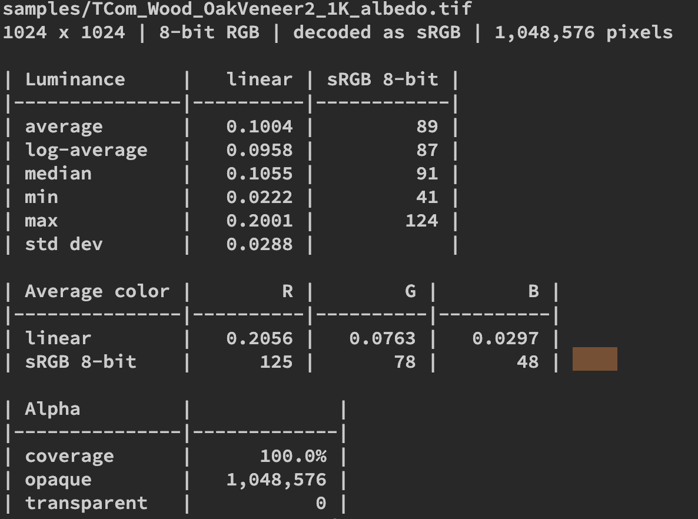

# Sploot

_Low to the ground, close to the pixels._ 🐕

A small command-line tool, written in Rust, for inspecting textures the way a technical artist actually needs to: comparing mip levels, previewing what compression does to an image, and pulling out numbers like average luminance.

> **Status:** early development. `sploot luma` works on single files; everything else is planned. The roadmap below is the source of truth for what works today.

---

## Why

Most image tools treat a texture as a single picture. In a real-time pipeline it's a mip chain, it gets block-compressed, and it lives in either linear or sRGB space. `sploot` is meant to answer quick questions about that, without opening a DCC or an engine:

- Do these mips actually match what a clean downsample would produce?
- What does BC1 vs BC7 (or fast vs slow quality) do to this texture, and where does it break?
- What's the average luminance of this albedo or HDR, measured correctly?

---

## Usage today

```sh
cargo run -- luma samples/TCom_Wood_OakVeneer2_1K_albedo.tif --srgb
```

or, with the binary on your path:

```sh
sploot luma <file> --srgb     # 8-bit albedo, UI, anything authored in sRGB
sploot luma <file> --linear   # data maps (normal, roughness, masks) and float sources
```

One of `--srgb` / `--linear` is required: sploot never guesses the color space silently.



The report shows:

- **Header:** size, storage format, how it was decoded, pixel count.
- **Luminance:** average, log-average, median, min, max and std dev, in linear and as the matching sRGB 8-bit value.
- **Average color:** linear RGB, sRGB 8-bit, and a color swatch (when the terminal supports true color and `NO_COLOR` isn't set).
- **Alpha:** coverage and opaque / transparent pixel counts.

---

## Roadmap

Legend: ✅ done · 🚧 in progress · ⬜ planned

### Core

| Status | Item                                                                                    |
| ------ | --------------------------------------------------------------------------------------- |
| ✅     | Load PNG / TGA / JPG / TIFF                                                             |
| ⬜     | Load DDS (including existing mip chains)                                                |
| 🚧     | Load EXR / HDR for float data (decoder enabled, not tested yet)                         |
| ✅     | Explicit color space handling (`--srgb` / `--linear`), never guess silently             |
| ⬜     | Detect color space from file metadata when no flag is given (explicit flag always wins) |
| ⬜     | Output report as plain text and JSON (`--json`)                                         |
| ⬜     | Write diff / heatmap images to disk                                                     |

### 1. Mipmap comparison

| Status | Item                                                                       |
| ------ | -------------------------------------------------------------------------- |
| ⬜     | Extract every mip level from a DDS                                         |
| ⬜     | Generate a reference mip chain from mip 0 (box, triangle, Kaiser, Lanczos) |
| ⬜     | Compare stored mips against the reference, per level                       |
| ⬜     | Compare two textures' mip chains against each other                        |
| ⬜     | Metrics per mip: max abs error, mean error, RMSE, PSNR                     |
| ⬜     | Per-channel results (R, G, B, A separately)                                |
| ⬜     | Diff heatmap output per mip                                                |
| ⬜     | Downsample in linear space when the source is sRGB                         |
| ⬜     | Normal map mode (renormalize, report angular error in degrees)             |

### 2. Compression preview

| Status | Item                                                            |
| ------ | --------------------------------------------------------------- |
| ⬜     | Encode to BC1, BC3, BC4, BC5, BC7                               |
| ⬜     | Encode to BC6H for HDR sources                                  |
| ⬜     | Quality presets per format (fast / normal / slow)               |
| ⬜     | Decode back and compare against the source                      |
| ⬜     | Metrics: RMSE, PSNR, max error, plus file size / bits per pixel |
| ⬜     | Side-by-side or tiled output image of all chosen settings       |
| ⬜     | Error heatmap per setting                                       |
| ⬜     | Summary table ranking settings by quality vs size               |
| ⬜     | ASTC block sizes (later)                                        |

### 3. Luminance

| Status | Item                                                                                 |
| ------ | ------------------------------------------------------------------------------------ |
| ✅     | Average luminance (Rec. 709 weights, computed in linear space)                       |
| ✅     | Log-average (geometric mean) luminance for HDR / exposure work                       |
| ✅     | Min / max / median luminance, std dev                                                |
| ✅     | Per-channel average                                                                  |
| 🚧     | Optional alpha mask (ignore transparent pixels): in core, not exposed in the CLI yet |
| ⬜     | Luminance histogram output                                                           |
| ⬜     | Batch mode over a folder, CSV output                                                 |

### 4. Image previewer

| Status | Item                                                                |
| ------ | ------------------------------------------------------------------- |
| ⬜     | Open a texture in a preview window (`sploot view`)                  |
| ⬜     | `sploot view` with no file opens an empty window waiting for a drop |
| ⬜     | Drag and drop a file onto the window to open it                     |
| ⬜     | Drop a second file to start an A/B compare against the first        |
| ⬜     | Drop a folder to browse its textures                                |
| ⬜     | Zoom and pan, with nearest-neighbor filtering when zoomed in        |
| ⬜     | Show individual channels: RGB, R, G, B, A, luminance                |
| ⬜     | Step through mip levels                                             |
| ⬜     | Exposure slider for HDR sources                                     |
| ⬜     | Pixel readout under the cursor (raw value + linear value)           |
| ⬜     | A/B compare: split slider or flip between two images                |
| ⬜     | View diff heatmaps and compression results from the other commands  |
| ⬜     | Quick in-terminal thumbnail when no window is wanted                |

### More to come

| Status | Item                 |
| ------ | -------------------- |
| ⬜     | _Add new ideas here_ |

---

## Planned usage

Only `sploot luma <file> --srgb|--linear` works today (see [Usage today](#usage-today)). The rest is the target interface.

```sh
# Compare a texture's stored mips against a clean reference chain
sploot mips rock_albedo.dds --filter kaiser --heatmap out/

# Compare two versions of the same texture, mip by mip
sploot mips old.dds new.dds

# Preview several compression settings side by side
sploot compress rock_albedo.png --formats bc1,bc7 --quality fast,slow --out out/

# Average luminance of an albedo map (sRGB source)
sploot luma rock_albedo.png --srgb

# Log-average luminance of an HDR, ignoring nothing
sploot luma sky.exr --log-average

# Machine-readable output
sploot luma textures/ --json

# Open the previewer, starting on mip 2, alpha channel
sploot view rock_albedo.dds --mip 2 --channel a

# A/B compare two textures with a split slider
sploot view old.dds new.dds

# Open an empty previewer and drag files onto it
sploot view
```

---

## Building

```sh
git clone https://github.com/chocomuffins/sploot.git
cd sploot
cargo build --release
```

The binary ends up in `target/release/sploot`.

```sh
cargo run -- luma <file> --srgb   # run the CLI (sploot-cli is the default member)
cargo test --workspace            # run all tests (plain `cargo test` only covers the CLI)
cargo fmt --all && cargo clippy --workspace --all-targets
```

CI runs fmt, clippy and tests on macOS, Windows and Ubuntu.

### Layout

```
crates/
  sploot-core/   library: color (sRGB <-> linear, luminance), stats, load, metrics
  sploot-cli/    the `sploot` binary
  sploot-gui/    previewer (placeholder for now)
samples/         test textures
assets/          icon, screenshots
```

---

## Candidate crates

Notes for myself, not commitments.

| Purpose                              | Crate                              | Status              |
| ------------------------------------ | ---------------------------------- | ------------------- |
| CLI arguments                        | `clap`                             | in use              |
| Common image formats, EXR / HDR      | `image`                            | in use              |
| DDS reading + BC encoding / decoding | `image_dds`                        | added, not used yet |
| Resampling filters                   | `fast_image_resize` or hand-rolled | candidate           |
| JSON output, cached stats            | `serde`, `serde_json`              | candidate           |
| Content hash for the cache           | `blake3`                           | candidate           |
| OS cache folder                      | `directories`                      | candidate           |
| Parallelism                          | `rayon` (via `image`)              | in use              |
| Preview window                       | `eframe` / `egui`                  | candidate           |
| In-terminal preview                  | `viuer`                            | candidate           |

---

## Notes and conventions

- All math (filtering, luminance, error metrics) happens in **linear float**. sRGB sources are decoded first.
- Error metrics are reported on the same scale as the source (0–1 for LDR, raw values for HDR).
- Luminance uses Rec. 709 / sRGB primaries: `Y = 0.2126 R + 0.7152 G + 0.0722 B`.

---

## License

MIT (TBD)
