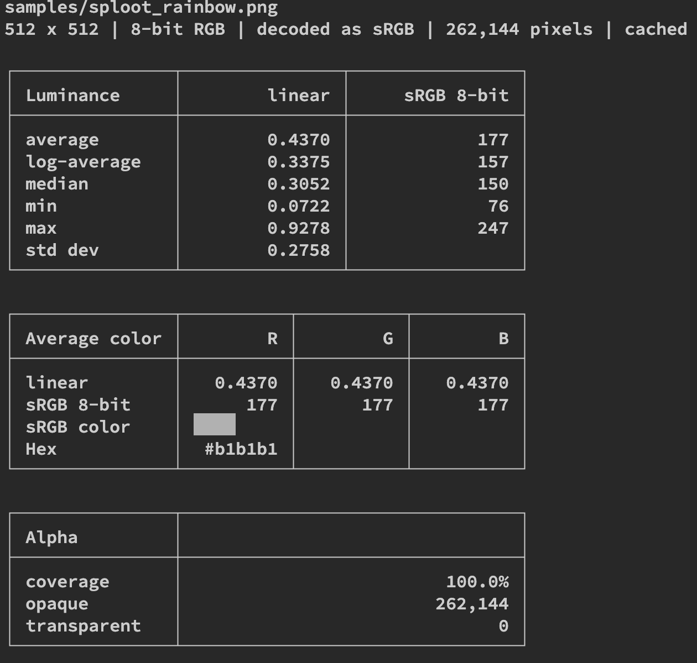

# Sploot: Texture Analyzer

**Fast command-line checks for game textures: luminance, color, mips and BC compression, without opening Photoshop.**

_Low to the ground, close to the pixels._ 🐕

A small command-line tool, written in Rust, for inspecting textures the way a technical artist actually needs to: comparing mip levels, previewing what compression does to an image, and pulling out numbers like average luminance.

> **Status:** early development. `sploot luma` works on single files; everything else is planned. The roadmap below is the source of truth for what works today.

---

## Why

A lot of what I check on a texture is the same few numbers: average luminance, average color, alpha coverage, whether the mips are right. Getting them usually means starting Photoshop or Substance Designer, waiting for it to load, and clicking through panels. That's a heavy tool for a quick question.

`sploot` is the lightweight version: a single binary that starts instantly, prints the answer in the terminal, and (once batch mode lands) runs the same check over a whole folder.

It also treats a texture the way a real-time pipeline does. A texture isn't a single picture: it's a mip chain, it gets block-compressed, and it lives in either linear or sRGB space. So `sploot` answers questions like:

- What's the average luminance of this albedo or HDR, measured correctly (in linear space)?
- What's the average luminance of every albedo in this folder?
- Do these mips actually match what a clean downsample would produce?
- What does BC1 vs BC7 (or fast vs slow quality) do to this texture, and where does it break?

Also, I just wanted to learn some more in-depth programming. I started with C++ but felt Rust was a bit more friendly coming from my Python background.

---

## Install

Download the archive for your platform from [Releases](https://github.com/chocomuffins/Sploot/releases), unpack it, and put `sploot` (or `sploot.exe`) somewhere on your `PATH`.

| Platform             | Archive                           |
| -------------------- | --------------------------------- |
| macOS, Apple Silicon | `aarch64-apple-darwin.tar.gz`     |
| macOS, Intel         | `x86_64-apple-darwin.tar.gz`      |
| Windows              | `x86_64-pc-windows-msvc.zip`      |
| Linux                | `x86_64-unknown-linux-gnu.tar.gz` |

The binaries aren't signed. On macOS, clear the download quarantine once with `xattr -d com.apple.quarantine sploot`. On Windows, SmartScreen may ask you to confirm the first run.

---

## Usage today

```sh
cargo run -- luma path/to/albedo.png --srgb
```

or, with the binary on your path:

```sh
sploot luma <file> --srgb     # 8-bit albedo, UI, anything authored in sRGB
sploot luma <file> --linear   # data maps (normal, roughness, masks) and float sources
```

One of `--srgb` / `--linear` is required: sploot (currently) does not guess the color space silently.

To check it works, try a test image from `samples/` with a known answer:
`sploot luma samples/sploot_checker.png --srgb` gives an average luminance of exactly 0.5.



The report shows:

- **Header:** size, storage format, how it was decoded, pixel count.
- **Luminance:** average, log-average, median, min, max and std dev, in linear and as the matching sRGB 8-bit value.
- **Average color:** linear RGB, sRGB 8-bit, and a color swatch (when the terminal supports true color and `NO_COLOR` isn't set).
- **Alpha:** coverage and opaque / transparent pixel counts.

---

## Roadmap

Legend: ✅ done · 🚧 in progress · ⬜ planned

### Core

| Status | Item                                                                                                    |
| ------ | ------------------------------------------------------------------------------------------------------- |
| ✅     | Load PNG / TGA / JPG / TIFF                                                                             |
| ⬜     | Load DDS (including existing mip chains)                                                                |
| 🚧     | Load EXR / HDR for float data (decoder enabled, not tested yet; half-float EXRs report as 32-bit float) |
| ⬜     | Images over 4K are measured at 4K for stats, to save memory (`--full-res` to skip)                      |
| ✅     | Explicit color space handling (`--srgb` / `--linear`), never guess silently                             |
| ⬜     | Detect color space from file metadata when no flag is given (explicit flag always wins)                 |
| ✅     | Plain-text report (tables)                                                                              |
| ⬜     | JSON output (`--json`)                                                                                  |
| ⬜     | Write diff / heatmap images to disk                                                                     |
| ⬜     | Cache results in the OS cache folder, keyed by content hash, sploot version and color space             |
| ⬜     | Tests: color conversions, stats, metrics                                                                |

### 1. Mipmap comparison

| Status | Item                                                                                                           |
| ------ | -------------------------------------------------------------------------------------------------------------- |
| ⬜     | Extract every mip level from a DDS                                                                             |
| ⬜     | Generate a reference mip chain from mip 0 (box, triangle, Kaiser, Lanczos), wrapping edges for tiling textures |
| ⬜     | Compare stored mips against the reference, per level                                                           |
| ⬜     | Compare two textures' mip chains against each other                                                            |
| ⬜     | Metrics per mip: max abs error, mean error, RMSE, PSNR                                                         |
| ⬜     | Per-channel results (R, G, B, A separately)                                                                    |
| ⬜     | Diff heatmap output per mip                                                                                    |
| ⬜     | Downsample in linear space when the source is sRGB                                                             |
| ⬜     | Normal map mode (renormalize, report angular error in degrees)                                                 |
| ⬜     | Alpha coverage per mip at a given cutoff, compared to mip 0 (foliage / fences thinning out)                    |
| ⬜     | Coverage-preserving alpha mips (scale alpha per level to keep mip 0's coverage)                                |

### 2. Compression preview

| Status | Item                                                            |
| ------ | --------------------------------------------------------------- |
| ⬜     | Encode to BC1, BC3, BC4, BC5, BC7                               |
| ⬜     | Encode to BC6H for HDR sources                                  |
| ⬜     | Quality presets per format (fast / normal / slow)               |
| ⬜     | Decode back and compare against the source                      |
| ⬜     | Metrics: RMSE, PSNR, max error, plus file size / bits per pixel |
| ⬜     | Side-by-side or tiled output image of all chosen settings       |
| ⬜     | Error heatmap per setting                                       |
| ⬜     | Summary table ranking settings by quality vs size               |
| ⬜     | ASTC block sizes (later)                                        |

### 3. Luminance and color stats

| Status | Item                                                                                                                     |
| ------ | ------------------------------------------------------------------------------------------------------------------------ |
| ✅     | Average luminance (Rec. 709 weights, computed in linear space)                                                           |
| ✅     | Log-average (geometric mean) luminance for HDR / exposure work                                                           |
| ✅     | Min / max / median luminance, std dev                                                                                    |
| ✅     | Per-channel average                                                                                                      |
| ✅     | Average color swatch in the terminal (true color; skipped when piped or `NO_COLOR` is set)                               |
| ✅     | HEX value of the average color, under the swatch                                                                         |
| ⬜     | White balance check (R / G and B / G of the average color)                                                               |
| ⬜     | Noise estimate (sigma from a high-pass residual)                                                                         |
| 🚧     | Optional alpha mask (ignore transparent pixels): in core, not exposed in the CLI yet; cutoff should follow the bit depth |
| ⬜     | Luminance histogram output                                                                                               |
| ⬜     | Batch mode over a folder, CSV output                                                                                     |
| ⬜     | Compare stats side by side across images or mips (luminance, average color), with the difference to the first            |

### 4. Image previewer

| Status | Item                                                                |
| ------ | ------------------------------------------------------------------- |
| ⬜     | Open a texture in a preview window (`sploot view`)                  |
| ⬜     | `sploot view` with no file opens an empty window waiting for a drop |
| ⬜     | Drag and drop a file onto the window to open it                     |
| ⬜     | Drop a second file to start an A/B compare against the first        |
| ⬜     | Drop a folder to browse its textures                                |
| ⬜     | Zoom and pan, with nearest-neighbor filtering when zoomed in        |
| ⬜     | Show individual channels: RGB, R, G, B, A, luminance                |
| ⬜     | Step through mip levels                                             |
| ⬜     | Exposure slider for HDR sources                                     |
| ⬜     | Pixel readout under the cursor (raw value + linear value)           |
| ⬜     | A/B compare: split slider or flip between two images                |
| ⬜     | View diff heatmaps and compression results from the other commands  |
| ⬜     | Quick in-terminal thumbnail when no window is wanted                |

### More to come

| Status | Item                                                                                                                                                                                          |
| ------ | --------------------------------------------------------------------------------------------------------------------------------------------------------------------------------------------- |
| ⬜     | Percentiles (1st / 99th) as a robust min / max for HDR                                                                                                                                        |
| ⬜     | Count infinities next to NaNs                                                                                                                                                                 |
| ⬜     | Write-up: foliage and fence shimmer. Coverage-preserving mips, alpha sharpening with screen-space derivatives, alpha-to-coverage vs. hashed / dithered alpha, and how each interacts with TAA |
| ⬜     | _Add new ideas here_                                                                                                                                                                          |

### Known issues

Marked `TODO(bug)` in the code.

| Where                              | Issue                                                                                                                                 |
| ---------------------------------- | ------------------------------------------------------------------------------------------------------------------------------------- |
| `sploot luma`                      | With no alpha cutoff, luminance and color include every pixel, but alpha coverage leaves out alpha-0 pixels, so the two can disagree. |
| `stats.rs`, `log_average`          | The epsilon assumes 0–1 values; on raw 8-bit or 16-bit data the result is wrong. The CLI always passes 0–1, so it isn't affected.     |
| `stats.rs`, `estimate_noise_sigma` | Panics on empty input. Not reachable from the CLI yet.                                                                                |

---

## Planned usage

Only `sploot luma <file> --srgb|--linear` works today (see [Usage today](#usage-today)). The rest is the target interface.

```sh
# Compare a texture's stored mips against a clean reference chain
sploot mips rock_albedo.dds --filter kaiser --heatmap out/

# Compare two versions of the same texture, mip by mip
sploot mips old.dds new.dds

# Preview several compression settings side by side
sploot compress rock_albedo.png --formats bc1,bc7 --quality fast,slow --out out/

# Average luminance of an albedo map (sRGB source)
sploot luma rock_albedo.png --srgb

# Log-average luminance of an HDR, ignoring nothing
sploot luma sky.exr --log-average

# Compare stats of several textures side by side (difference to the first)
sploot luma rock_old.png rock_new.png rock_v3.png --srgb

# Machine-readable output
sploot luma textures/ --json

# Open the previewer, starting on mip 2, alpha channel
sploot view rock_albedo.dds --mip 2 --channel a

# A/B compare two textures with a split slider
sploot view old.dds new.dds

# Open an empty previewer and drag files onto it
sploot view
```

---

## Building

```sh
git clone https://github.com/chocomuffins/sploot.git
cd sploot
cargo build --release
```

The binary ends up in `target/release/sploot`.

```sh
cargo run -- luma <file> --srgb   # run the CLI (sploot-cli is the default member)
cargo test --workspace            # run all tests (plain `cargo test` only covers the CLI)
cargo fmt --all && cargo clippy --workspace --all-targets
```

CI runs fmt, clippy and tests on macOS, Windows and Ubuntu.

### Releasing

1. Bump `version` under `[workspace.package]` in the root `Cargo.toml`, then run `cargo build` so `Cargo.lock` updates.
2. Commit and push to `main`.
3. Tag and push the tag:

   ```sh
   git tag v0.1.0
   git push origin v0.1.0
   ```

The Release workflow checks that the tag matches the Cargo version, then runs the tests, builds for every platform, and publishes a GitHub Release with the archives, `SHA256SUMS.txt` and auto-generated notes.

### Layout

```
crates/
  sploot-core/   library: color (sRGB <-> linear, luminance), stats, load, metrics
                 + mips, compress, heatmap, cache: planned (TODOs only)
  sploot-cli/    the `sploot` binary
  sploot-gui/    previewer (placeholder for now)
samples/         test textures and DDS files (see samples/README.md)
tools/           scripts that generate the test textures
assets/          icon, screenshots
```

---

## Crates

In use, added for upcoming work, and candidates (not commitments).

| Purpose                              | Crate                              | Status               |
| ------------------------------------ | ---------------------------------- | -------------------- |
| CLI arguments                        | `clap`                             | in use (cli)         |
| Common image formats, EXR / HDR      | `image`                            | in use (core: load)  |
| Parallelism                          | `rayon` (via `image`)              | in use               |
| Cache file names (hash of the key)   | `blake3`                           | in use (core: cache) |
| Cache files; `--json` output later   | `serde`, `serde_json`              | in use (core: cache) |
| DDS reading + BC encoding / decoding | `image_dds`                        | added, not used yet  |
| OS cache folder                      | `directories`                      | candidate            |
| Resampling filters                   | `fast_image_resize` or hand-rolled | candidate            |
| Preview window                       | `eframe` / `egui`                  | candidate            |
| In-terminal preview                  | `viuer`                            | candidate            |

---

## Notes and conventions

- All math (filtering, luminance, error metrics) happens in **linear float**. sRGB sources are decoded first.
- Error metrics are reported on the same scale as the source (0–1 for LDR, raw values for HDR).
- Luminance uses Rec. 709 / sRGB primaries: `Y = 0.2126 R + 0.7152 G + 0.0722 B`.

---

## License

MIT. See [LICENSE](LICENSE).
